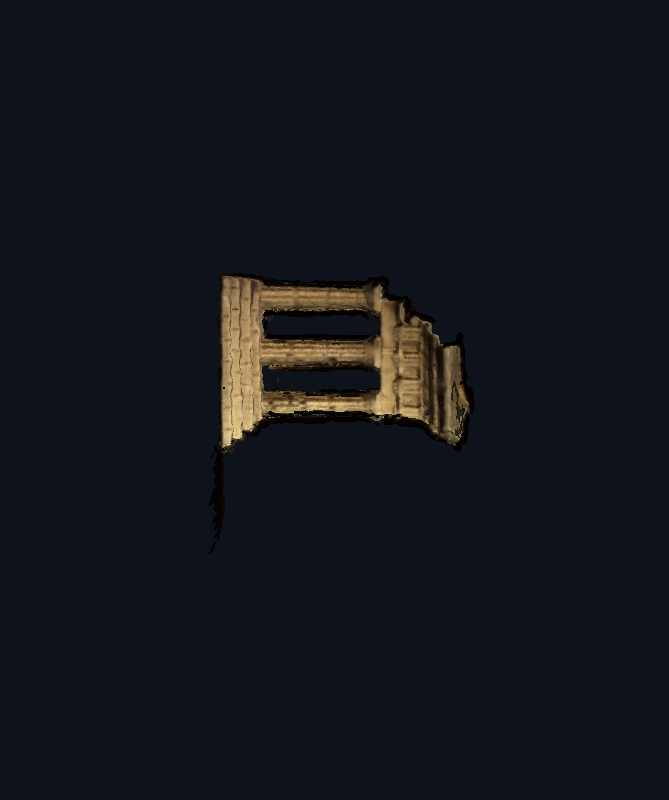
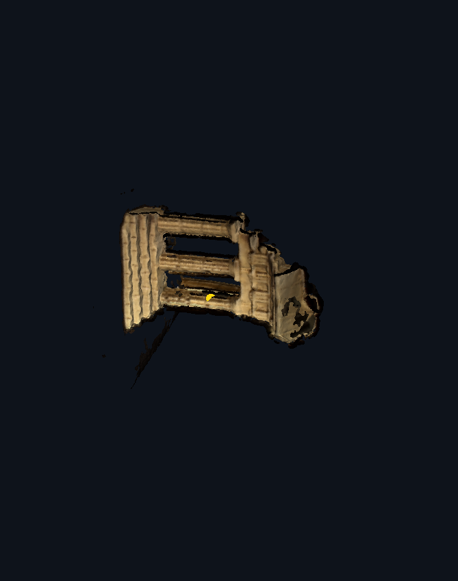
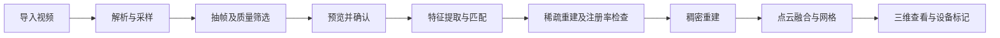

# Three-Dimensional Vision Inspection Platform

## 基于 C++ / Qt 的三维重建与设备视觉巡检软件

中文 | [English](README_EN.md)

将照片或视频、COLMAP 三维重建、三维设备标记、仪表资产、人工确认读表和实时状态管理连接到同一个桌面工作区。

**开发进展更新：2026-10-29。** 当前界面采用 Qt Quick / QML，嵌入既有 Qt Widgets / OpenGL 三维查看器。项目保留 `v0.3.0` 版本号；本次同步是源码与文档更新，不代表发布新的稳定版本。

## 当前功能

| 模块 | 已实现内容 |
| --- | --- |
| 工作区 | 创建/打开项目、图像导入、SHA-256 去重、缩略图和项目 JSON 持久化 |
| 三维重建 | 照片导入；视频信息解析、自动采样、模糊/重复帧筛选、抽帧预览；复用 COLMAP 重建流程 |
| 视频匹配 | 相邻帧匹配、跨时段匹配和传递匹配，记录注册率和轨迹告警 |
| 中断处理 | 视频任务在稠密阶段取消或中断后，可校验已有结果并继续；保留已完成的深度图 |
| 三维查看 | OpenGL 网格显示、旋转/平移/缩放、视图复位、表面拾取和设备标记 |
| 仪表巡检 | GaugeAsset、人工 ROI、OpenCV 指针几何分析、读数确认和 InspectionRecord 历史 |
| 实时监控 | Mock Sensor 和只读 Modbus TCP，状态规则及标记颜色联动 |
| 设置 | 项目偏好、查看器设置和重建引擎开发配置 |

Local AI worker 的任务协议与部署脚本位于 [app/local_ai](app/local_ai/README.md)。该模块仍是实验性扩展，不能据此宣称已具备通用 AI 模型修复能力。

## 已构建模型展示

保留已有实际重建模型在 OpenGL 查看器中的展示，包括模型浏览、视角交互和三维设备标记。以下图片来自早期客户端的实际运行；新版软件完整界面见下一节。

| 模型总览 | 视角交互与设备标记 |
| --- | --- |
|  |  |

## 当前界面

以下为 2026-10-29 从实际客户端采集的新版完整界面。截图展示未加载项目的初始状态，不代表重建质量、真实设备连接或自动读表验证。

### 项目总览


### 重建任务


### 视觉巡检


模型展示保留早期客户端的真实截图；当前软件界面以本节的新版截图为准。

## 视频到三维模型



1. 新建或打开项目，导入照片或视频。未建项目时，导入入口会先引导创建项目。
2. 视频模式先抽帧并生成预览；默认由用户确认后启动重建，自动继续为可选项。
3. 视频使用顺序匹配并补充跨时段和传递匹配；照片使用穷举匹配。
4. 视频主模型注册率不足 50% 时停止后续稠密重建，并在页面显示失败原因。
5. 完成稠密、融合和网格生成后，可进入三维场景。模型后处理失败时，流程可能回退为原始网格，并记录原因。
6. 若在视频稠密阶段取消，重新打开同一项目后可点击“继续三维重建”。该入口不表示任意阶段都支持断点恢复。

## 构建与运行

### 依赖

- Windows x64、Visual Studio 2022 / MSVC、CMake 3.21+、C++17。
- Qt 6.5+：Core、Gui、Widgets、OpenGL、OpenGLWidgets、Network、SerialBus、SerialPort、Qml、Quick、QuickWidgets、QuickControls2；构建测试还需 Qt Test。
- OpenCV 4.14+：`core`、`imgproc`、`imgcodecs`。
- COLMAP 3.11.1 Windows CUDA：外部重建引擎，运行时检查版本，不随源码仓库提供。
- FFmpeg / ffprobe：视频功能需要的外部工具，不随源码仓库提供。
- Open3D 及 meshoptimizer：可选的几何后处理依赖；以 CMake 配置结果为准。

从仓库根目录执行，替换依赖路径占位符：

```powershell
cmake -S app -B build -G "Visual Studio 17 2022" -A x64 -DCMAKE_PREFIX_PATH="<Qt-directory>" -DOpenCV_DIR="<OpenCV-config-directory>" -DBUILD_TESTING=ON -DVISION3DINSPECTOR_BUILD_TESTS=ON
cmake --build build --config Release
```

需要执行自动化测试时：

```powershell
ctest --test-dir build -C Release --output-on-failure
```

运行时应使用与构建配置匹配的 Qt / OpenCV DLL 和 QML 插件。依赖路径可配置在本机 `CMakeUserPresets.json` 或当前终端环境中，个人配置不提交到仓库。本次文档同步未重新运行构建或测试，不将历史通过数作为当前提交的验证结果。

### 外部工具位置

- FFmpeg：应用目录下 `tools/ffmpeg/bin/ffmpeg.exe` 和 `ffprobe.exe`；开发目录也支持仓库根目录的 `tools/ffmpeg/bin/`。不修改系统 PATH。
- COLMAP：优先发现应用目录下 `runtime/reconstruction/engine/`；开发配置可指向包含 `COLMAP.bat` 和 `bin/colmap.exe` 的目录。
- 外部二进制及其许可证须由使用者按对应发行版准备，参见 [THIRD_PARTY_NOTICES.md](THIRD_PARTY_NOTICES.md)。

## 源码结构

```text
app/
  src/app/              # 主窗口、QML 视图模型、设置
  src/qml/              # 页面、主题、导航与组件
  src/core/video/       # 视频探测、抽帧、采样和筛选
  src/core/reconstruction/ # 重建任务、工作目录和产物校验
  src/core/device/      # 设备标记、仪表和状态规则
  src/core/vision/      # 人工确认的视觉读表
  src/core/realtime/    # Mock / 只读 Modbus 数据源
  src/render/           # OpenGL 渲染
  src/widgets/          # 嵌入式查看器及对话框
  src/geometry_worker/  # 几何后处理进程
  local_ai/             # 实验性本地任务 worker
  tests/                # Qt Test 源码
  cmake/                # 构建辅助脚本
docs/images/            # 真实客户端截图
```

## 已知限制

- 重建完成或注册率较高不保证模型完整、表面平滑或达到工业测量精度。拍摄重叠、纹理、反光和运动模糊都会影响结果。
- 相对模糊阈值不能保证一整批模糊图像被全部识别，仍需人工检查抽帧预览。
- 进度百分比目前是粗略状态值，可能长时间停在 92%；可结合当前阶段和任务日志判断计算情况。
- 视觉读表需要人工 ROI 和确认，不是已经验证的通用 AI/YOLO 自动读表系统。
- Modbus TCP 仅提供只读接口；历史验证限本地 loopback，不能宣称真实 PLC 已验证。
- 未做物理尺度标定时，重建坐标不代表毫米级物理坐标。
- 本仓库不包含安装器、依赖运行时、私人项目、照片/视频数据、模型、权重、缓存或重建输出。

## 许可证

项目采用 [Apache License 2.0](LICENSE)。第三方依赖及分发边界见 [THIRD_PARTY_NOTICES.md](THIRD_PARTY_NOTICES.md)。
