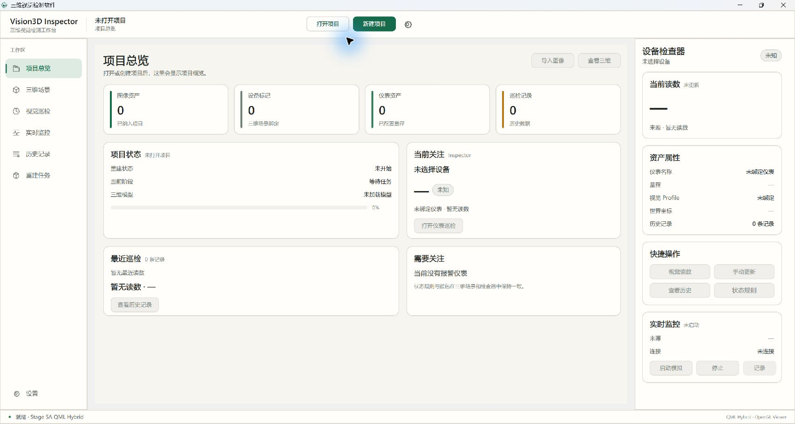
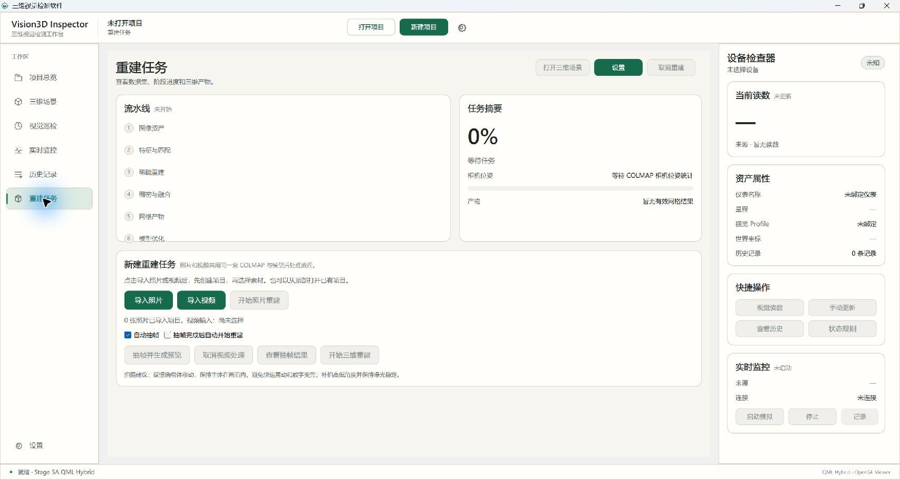
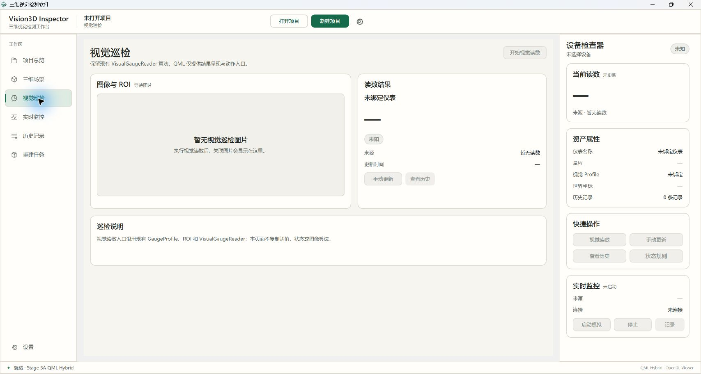

# Three-Dimensional Vision Inspection Platform

## A C++ / Qt desktop workspace for 3D reconstruction and equipment inspection

[中文](README.md) | English

Connect photos or video, COLMAP reconstruction, 3D device markers, gauge assets, reviewed visual readings and live status in one desktop workspace.

**Development update: 2026-10-29.** The current shell uses Qt Quick / QML with the existing Qt Widgets / OpenGL viewer embedded inside it. The project retains version `0.3.0`; this source and documentation update does not create a new stable release.

## Implemented capabilities

| Area | Scope |
| --- | --- |
| Workspace | Project creation/opening, image import, SHA-256 deduplication, thumbnails and JSON persistence |
| Reconstruction | Photo input; video probing, sampling, blur/duplicate filtering and frame preview; shared COLMAP pipeline |
| Video matching | Contiguous neighbours, cross-time pairs and transitive matching; registration and trajectory diagnostics |
| Continuation | Resume a cancelled/interrupted video task at the dense stage after checking saved artifacts; retain completed depth maps |
| 3D viewer | Orbit, pan, zoom, view reset, surface picking and device markers |
| Gauge inspection | GaugeAsset, manual ROI, OpenCV pointer geometry, confirmed readings and InspectionRecord history |
| Realtime | Mock Sensor, read-only Modbus TCP and status-linked marker colors |
| Settings | Project preferences, viewer settings and development engine configuration |

The task protocol and deployment scripts in [app/local_ai](app/local_ai/README.md) are experimental extensions. Their presence does not establish general AI mesh-repair capability.

## Current interface

These screenshots were captured as full-window views from the actual client on 2026-10-29. They show the initial state without a loaded project; they are not evidence of reconstruction quality, physical device connectivity or automated gauge-reading accuracy.

### Project overview



### Reconstruction tasks



### Visual inspection



Earlier Widgets screenshots remain in `docs/images/` as historical material and are no longer presented here as the current interface.

## Video-to-model workflow

1. Create/open a project and import photos or video. Import prompts for project creation when necessary.
2. Extract and review video frames before starting reconstruction. Automatic continuation is optional and disabled by default.
3. Video uses sequential matching supplemented by cross-time and transitive matching; photos use exhaustive matching.
4. A video primary-model registration ratio below 50% stops downstream dense reconstruction. The page displays the failure reason.
5. Dense stereo, fusion and meshing produce the viewer input. A post-processing failure can fall back to the raw mesh with the reason recorded.
6. Reopen the same project and choose “继续三维重建” to continue a video task cancelled at the dense stage. Arbitrary-stage resume is not implemented.

## Build and runtime

Requirements:

- Windows x64, Visual Studio 2022 / MSVC, CMake 3.21+, C++17.
- Qt 6.5+: Core, Gui, Widgets, OpenGL, OpenGLWidgets, Network, SerialBus, SerialPort, Qml, Quick, QuickWidgets and QuickControls2; Qt Test for test targets.
- OpenCV 4.14+: `core`, `imgproc`, `imgcodecs`.
- External COLMAP 3.11.1 Windows CUDA, checked at runtime; external FFmpeg and ffprobe for video.
- Optional Open3D and meshoptimizer for geometry post-processing, subject to CMake discovery.

Run from the repository root and replace the dependency placeholders:

```powershell
cmake -S app -B build -G "Visual Studio 17 2022" -A x64 -DCMAKE_PREFIX_PATH="<Qt-directory>" -DOpenCV_DIR="<OpenCV-config-directory>" -DBUILD_TESTING=ON -DVISION3DINSPECTOR_BUILD_TESTS=ON
cmake --build build --config Release
```

To run automated tests:

```powershell
ctest --test-dir build -C Release --output-on-failure
```

Use Qt/OpenCV DLLs and QML plugins matching the build configuration. Keep personal dependency paths in an untracked `CMakeUserPresets.json` or the current terminal environment. This documentation synchronization does not rerun the build or tests; historical pass counts are not claimed for the new commit.

External tools:

- FFmpeg: `tools/ffmpeg/bin/ffmpeg.exe` and `ffprobe.exe` under the application directory, or `tools/ffmpeg/bin/` under the repository root during development. Discovery does not modify system PATH.
- COLMAP: prefer `runtime/reconstruction/engine/` under the application directory; a development setting may point to a directory containing `COLMAP.bat` and `bin/colmap.exe`.
- No dependency binaries are bundled. Prepare each distribution and its applicable licenses; see [THIRD_PARTY_NOTICES.md](THIRD_PARTY_NOTICES.md).

## Source layout

- `app/src/app/`, `app/src/qml/`: desktop shell, view model, pages, preferences and theme.
- `app/src/core/video/`, `app/src/core/reconstruction/`: probing, extraction, filtering, tasks and artifact validation.
- `app/src/core/device/`, `vision/`, `realtime/`: markers, gauges, reviewed readings and data sources.
- `app/src/render/`, `widgets/`: OpenGL rendering, embedded viewer and dialogs.
- `app/src/geometry_worker/`: geometry post-processing process.
- `app/local_ai/`: experimental local task worker.
- `app/tests/`, `app/cmake/`: test sources and build helpers.
- `docs/images/`: actual client screenshots.

## Limitations

- Completion or high registration does not guarantee a complete/smooth model or industrial measurement accuracy. Overlap, texture, reflections and motion blur affect results.
- Relative blur thresholds can miss uniformly blurred input; review the frame preview manually.
- Progress is currently approximate and may remain at 92% during later computation. Check the current stage and task logs.
- Gauge reading requires manual ROI and confirmation; general AI/YOLO automatic-reading accuracy is not established.
- Modbus is read-only. Historical validation used a local loopback server, not a physical PLC.
- Reconstruction coordinates are not millimetre-accurate physical coordinates without scale calibration.
- Installers, dependency runtimes, private projects, input media, meshes, weights, caches and reconstruction outputs are excluded.

## License

[Apache License 2.0](LICENSE). Dependency and redistribution boundaries: [THIRD_PARTY_NOTICES.md](THIRD_PARTY_NOTICES.md).
